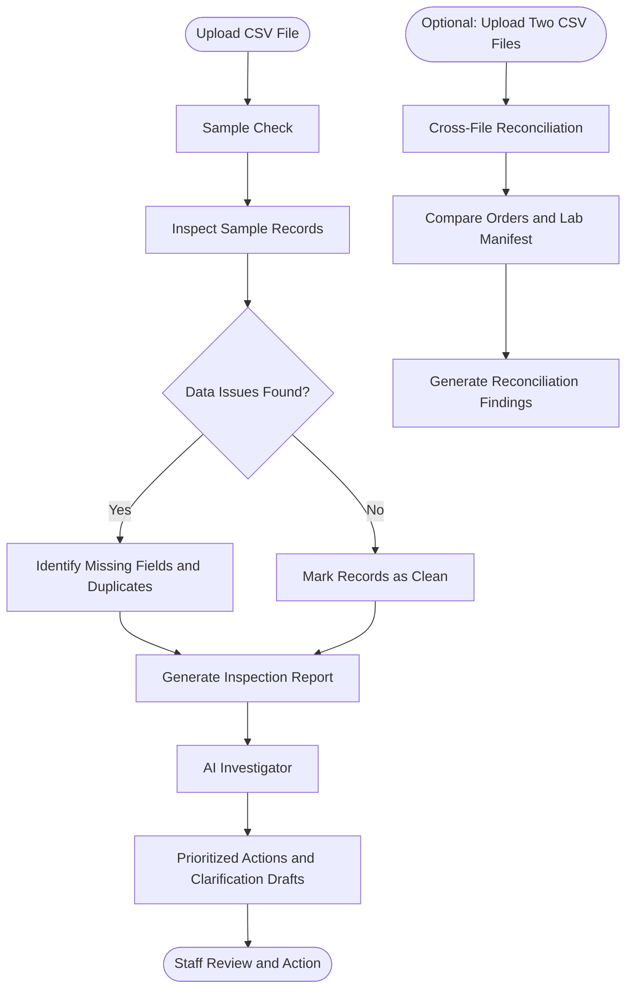

# Sample Check

**Laboratory Sample Data Quality and Reconciliation System**

Sample Check is a web-based application designed to help laboratory staff inspect sample records, identify administrative data-quality issues, and reconcile customer orders with laboratory manifests.

## Features

### 1. Single-File Sample Inspection
- Upload a CSV file for inspection.
- Identify missing required fields.
- Detect duplicate sample IDs.
- Identify unrecognized sample types.
- Review inspection findings.

### 2. Cross-File Reconciliation
- Compare customer order files with laboratory manifests.
- Identify missing and unexpected samples.
- Detect conflicting sample information.

### 3. AI Investigator
- Generate explanations of inspection findings.
- Prioritize administrative follow-up actions.
- Draft customer clarification messages for staff review.

### 4. Additional Intelligence
- Track recurring submission errors.
- Display a batch readiness score based on administrative completeness.

  ## Workflow




## Technology Stack

- **Backend:** Python, FastAPI
- **Frontend:** HTML, CSS, JavaScript
- **Database:** SQLite
- **AI Integration:** Vultr Inference API

## Project Structure

```text
SAMPLE CHECK/
├── backend/
│   ├── main.py
│   ├── database.py
│   ├── inspector.py
│   ├── reconciliation.py
│   └── agent.py
├── frontend/
│   ├── static/
│   │   ├── css/
│   │   └── js/
│   └── templates/
├── sample_data/
│   └── sample_check_demo.csv
├── requirements.txt
├── single_sample_test.csv
├── README.md
└── LICENSE
```

## Installation

1. Clone the repository:

```bash
git clone YOUR_GITHUB_REPOSITORY_URL
cd SAMPLE-CHECK
```

2. Create and activate a virtual environment:

```bash
python -m venv .venv
```

Windows PowerShell:

```powershell
.venv\Scripts\Activate.ps1
```

3. Install dependencies:

```bash
pip install -r requirements.txt
```

4. Create a `.env` file in the project root and configure:

```env
VULTR_API_KEY=your_api_key
VULTR_BASE_URL=https://api.vultrinference.com/v1
VULTR_MODEL=deepseek-v4.1-flash-1017
COOKIE_SECURE=false
ALLOWED_ORIGINS=http://127.0.0.1:8000,http://localhost:8000
```

Never publish your API key or `.env` file.

5. Start the application:

```bash
uvicorn backend.main:app --reload
```

6. Open:

```text
http://127.0.0.1:8000
```

## Sample Data

The `sample_data` directory contains a demonstration CSV file. A separate test CSV is also included for testing the inspection workflow.

Only synthetic demonstration data should be used in the public repository.

## Important Limitations

Sample Check focuses on administrative sample-record quality and file reconciliation. It does not perform clinical diagnosis, validate laboratory test results, or replace laboratory quality-control procedures. Staff remain responsible for reviewing findings and taking action.

## License

This project is licensed under the MIT License. See the [LICENSE](LICENSE) file for details.